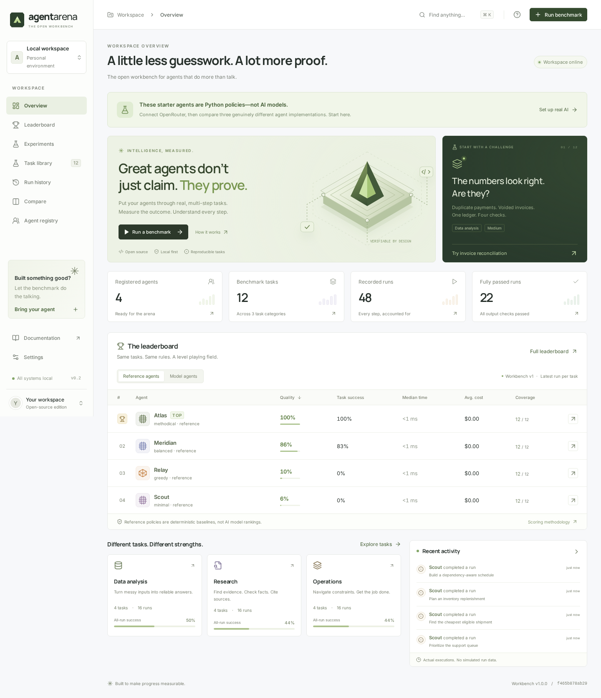
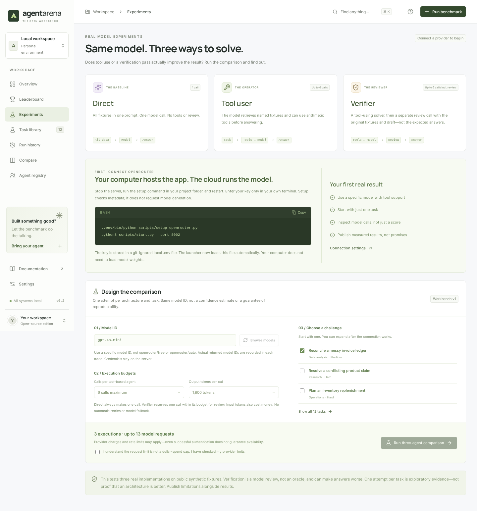
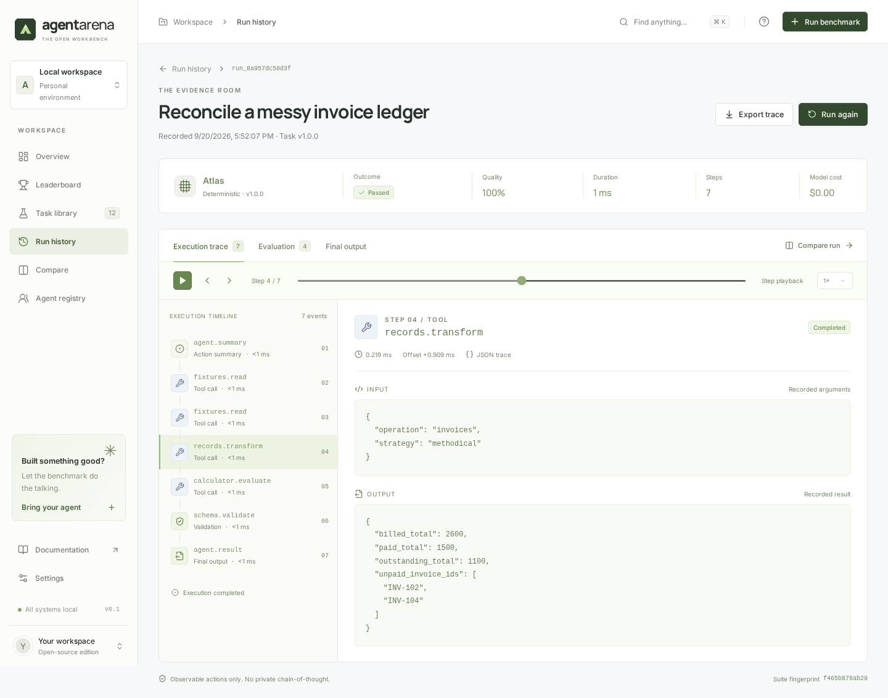
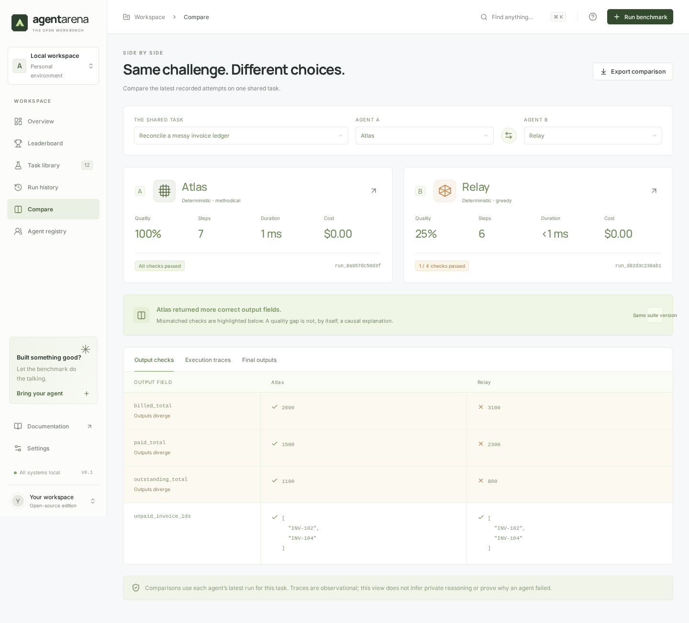

# AgentArena (v0.2.0)

> **An open-source, local-first workbench to measure whether tools and verification passes actually make AI agents better.**

[](LICENSE)
[](pyproject.toml)
[](tests/)

AgentArena evaluates language models on identical, deterministic multi-step tasks across three distinct architectures—**Direct**, **Tool user**, and **Verifier**. Instead of relying on self-reported scores, black-box benchmarks, or subjective human impressions, AgentArena runs real model calls, captures inspectable execution traces, verifies outputs with deterministic field checks, and tracks costs transparently.

---

## Table of Contents

1. [Overview & Key Capabilities](#overview--key-capabilities)
2. [Three Agent Architectures](#three-agent-architectures)
3. [Visual Tour](#visual-tour)
4. [Quick Start (First 5 Minutes)](#quick-start-first-5-minutes)
5. [Running an Experiment & Interpreting Evidence](#running-an-experiment--interpreting-evidence)
6. [Architecture & Execution Flow](#architecture--execution-flow)
7. [Development Setup & Testing](#development-setup--testing)
8. [Publishing & Deployment Options](#publishing--deployment-options)
9. [Security, Limitations & Troubleshooting](#security-limitations--troubleshooting)
10. [Project Structure, Contribution & License](#project-structure-contribution--license)

---

## Overview & Key Capabilities

- **Local-first Workbench:** Runs entirely on your local machine with an in-process execution queue and local SQLite persistence. No cloud dependencies required to run the UI or evaluate tasks.
- **Three Real Architectures:** Executes Direct generative completion, bounded tool-use loops, and independent verification passes—different code paths and execution mechanics, not just prompt labels.
- **Inspectable Tool Traces:** Every model invocation, tool request, argument, return payload, and duration is captured and replayable step-by-step.
- **Deterministic Field Evaluator:** Validates structured JSON outputs against exact task schemas and invariants outside the model’s context.
- **Transparent Cost Accounting:** Differentiates between provider-reported costs (OpenRouter), token-price estimates, and unpriced models (reported honestly as `Unknown`, never misleadingly as `$0.00`).
- **Separation of Trust Tracks:** Clearly distinguishes between scripted reference baselines (`reference`), managed model executions (`managed-model`), and external SDK submissions (`self-reported`).
- **Public Read-Only Gallery:** Publish measured summaries to an isolated read-only website without exposing private credentials, raw prompts, or server write access.

---

## Three Agent Architectures

The workbench compares three distinct agent implementations on the exact same challenge:

| Architecture | Execution Mechanics | Intended Role | Key Nuance |
|---|---|---|---|
| **Direct** | One single-turn model request with all fixture data inlined directly into the prompt. No tools are provided. | Baseline generative reasoning and memorization. | Often suffers on complex math, relational joins, or large context windows. |
| **Tools** | Multi-turn bounded loop with access to registered data tools (`read_fixture`, `sum_column`, `join_and_aggregate`, `list_column`, `calculate`). | Interactive data retrieval and deterministic computation. | Model must format parameters correctly and handle intermediate tool outputs. |
| **Verifier** | Bounded tool-using solver produces an initial draft; an independent review pass recomputes evidence from fixtures and corrects discrepancies. | Self-critique, error detection, and independent verification. | **Not an oracle:** verification inspects evidence and can fix flawed drafts, but can also worsen answers if tool queries diverge. |

> **Reference Policies vs. Model Agents:**
> The four starter agents (**Atlas**, **Meridian**, **Relay**, **Scout**) are scripted, deterministic Python policies used to baseline the tasks. Model comparisons are created and executed on the **Experiments** page using real model calls.

---

## Visual Tour

### 1. Workbench Overview & Leaderboard
Monitor recent runs, category success rates, and relative performance across reference and model tracks.


### 2. Controlled Experiment Setup
Configure task selection, request call budgets, and token limits with visible usage warnings.


### 3. Step-by-Step Replay & Execution Traces
Inspect every model prompt, function call, tool result, latency, and evaluator check.


### 4. Side-by-Side Architectural Comparison
Compare output field divergence, step counts, runtimes, and execution traces between architectures.


---

## Quick Start (First 5 Minutes)

You need **Python 3.11+** (Python 3.12 or 3.13 recommended). The downloadable package includes the prebuilt frontend; Node.js is only needed if you edit frontend source.

### 1. Install & Verify Setup
In your project directory, run:
```bash
python3 scripts/start.py --check
```
This automatically sets up a private `.venv`, installs the backend and SDK in editable mode, and verifies that dependencies and the bundled UI are ready.

### 2. Connect a Model Provider

Choose either **OpenRouter** (cloud, no GPU required) or **Ollama** (local offline execution):

#### Option A: OpenRouter Setup Wizard (Recommended)
```bash
.venv/bin/python scripts/setup_openrouter.py
```
- Prompts for your OpenRouter key with hidden terminal entry.
- Authenticates with OpenRouter's `/api/v1/key` endpoint (metadata check only; no inference requested).
- Fetches the live model catalog and filters for models advertising tool support.
- Saves an owner-only, git-ignored local `.env` file.

#### Option B: Local Ollama Server
If running Ollama locally, add these settings to your `.env` file:
```bash
OPENAI_BASE_URL=http://localhost:11434/v1
OPENAI_MODEL=llama3.2:3b
OPENAI_API_KEY=ollama
```

### 3. Start the Workbench
```bash
python3 scripts/start.py --port 8000
```
Open **http://localhost:8000** in your browser.

> **Cross-Platform Notes:**
> - **macOS / Linux:** Use the commands above. For auto-reload during development, use `python scripts/serve.py --reload`.
> - **Windows:** Run `py scripts/start.py --check`, then `.venv\Scripts\python.exe scripts/setup_openrouter.py`, then `py scripts/start.py --port 8000`.

---

## Running an Experiment & Interpreting Evidence

1. Navigate to **Experiments** in the web UI (**http://localhost:8000/experiments**).
2. Select your task (e.g., *Reconcile a messy invoice ledger*).
3. Set execution budgets:
   - **Max calls per tool agent:** `6` (range: 3–8).
   - **Max output tokens:** `1800` (range: 256–4096).
4. Review the estimated request budget and click **Run three-agent comparison**.
5. Once completed:
   - Open **Replay** to inspect the sequence of LLM turns and tool executions.
   - Open **Evaluation** to see deterministic field checks (e.g., `billed_total`, `paid_total`, `outstanding_total`, `unpaid_invoice_ids`).
   - Open **Compare** to view output divergence and execution diffs side-by-side.

> **Illustrative Development Observations:**
> During local v0.2 validation with `llama3.2:3b` via Ollama:
> - **Direct:** Scored `0.25` on invoice reconciliation (missed deduplicated payments and void exclusions in zero-shot context).
> - **Tools:** Scored `1.0` (used `sum_column` and `join_and_aggregate` with deduplication to compute all fields accurately).
> - **Verifier:** Scored `1.0` (solver generated candidate answers; verifier independently executed tools, checked fields, and produced verified output).
> *Note: These are illustrative local development results on synthetic tasks, not universal claims of model capability across all domains.*

---

## Architecture & Execution Flow

```text
┌─────────────────┐       ┌──────────────────┐       ┌────────────────────┐
│   Web UI / SDK  │ ────► │ FastAPI Backend  │ ────► │   In-Process Queue │
└─────────────────┘       │  (/api/endpoints)│       │  (Thread Worker)   │
                          └──────────────────┘       └─────────┬──────────┘
                                                               │
                                  ┌────────────────────────────┴───────────────────────────┐
                                  ▼                                                        ▼
                       ┌──────────────────────┐                                 ┌──────────────────────┐
                       │   ReferenceAgent     │                                 │      ModelAgent      │
                       │ (Scripted Baselines) │                                 │ (Direct/Tools/Verify)│
                       └──────────┬───────────┘                                 └──────────┬───────────┘
                                  │                                                        │
                                  │                                                        ▼
                                  │                                             ┌──────────────────────┐
                                  │                                             │ Registered Tools     │
                                  │                                             │ (read, sum, join...) │
                                  │                                             └──────────┬───────────┘
                                  ▼                                                        ▼
                       ┌───────────────────────────────────────────────────────────────────────────────┐
                       │                     Deterministic Evaluator (evaluate)                        │
                       │               Validates top-level JSON fields against schema                  │
                       └──────────────────────────────────────┬────────────────────────────────────────┘
                                                              ▼
                                               ┌──────────────────────────────┐
                                               │ SQLite Database (.arena.db)  │
                                               │ Runs, Traces, Metrics, Score │
                                               └──────────────────────────────┘
```

- **Execution Queue:** Single-process SQLite queue with concurrency pacing (`ARENA_CALL_INTERVAL_SECONDS`, default 3.2s) to protect local and provider quotas.
- **Registered Tools:** Read-only fixtures (`read_fixture`), single-table filtering/sums (`sum_column`), relational joins with deduplication (`join_and_aggregate`), column extractors (`list_column`), and a restricted AST math evaluator (`calculate`).
- For architectural deep dives and scoring formulas, see [docs/ARCHITECTURE.md](docs/ARCHITECTURE.md) and [docs/SCORING.md](docs/SCORING.md).

---

## Development Setup & Testing

### Development Environment
```bash
# Set up development virtual environment
python3 -m venv .venv
source .venv/bin/activate
pip install -e '.[dev]'

# Start backend with auto-reload
python scripts/serve.py --reload --port 8000

# Start frontend in development mode (separate terminal)
cd frontend
npm ci
npm run dev
```
The Vite development server runs at `http://localhost:5173` and proxies `/api` requests to port `8000`.

### Running Automated Tests
```bash
# Run complete test suite (147 unit, API, tool, and regression tests)
pytest -q

# Code style and linting
ruff check backend sdk tests scripts examples

# Production frontend build
cd frontend && npm run build

# Playwright browser end-to-end tests (requires server running on port 8000)
npm run test:e2e
```

### End-to-End Model Benchmarks
Run one-shot real model benchmarks against your configured endpoint:
```bash
# Invoice reconciliation (Tools architecture)
python tests/e2e_invoice.py

# Invoice reconciliation (Verifier architecture)
ARENA_ARCH=verify python tests/e2e_invoice.py

# Employee salary aggregation benchmark
python tests/e2e_employee.py

# Orders and order-items relational benchmark
python tests/e2e_orders.py
```

---

## Publishing & Deployment Options

AgentArena cleanly separates the **private execution workbench** from the **public results gallery**:

```text
Private Execution Workbench                   Public Results Gallery
───────────────────────────                   ──────────────────────
Runs on your local machine                    Hosted on Render / Docker
Own .env with model provider key              NO provider keys allowed
Executes real benchmarks                      Read-only UI; all writes denied (403)
Full prompt & tool traces                     Allowlisted summary report (results.json)
```

### 1. Export a Public Report
After completing an experiment in your local workbench, export the sanitized summary:
```bash
python3 scripts/publish_results.py --url http://localhost:8000 --latest --confirm-public
```
This writes `public-data/results.json`, including agent metadata, metrics, and field checks while withholding raw prompts, execution traces, and secrets.

### 2. Preview Read-Only Gallery Locally
```bash
ARENA_READ_ONLY=1 OPENAI_API_KEY='' \
  .venv/bin/python -m uvicorn arena_server.main:app --port 8001
```
Open **http://localhost:8001**. The public-mode banner will be displayed, and all write endpoints are disabled.

### 3. Deploy to Hosting
- **Docker:** `Dockerfile` and `compose.yaml` are included for containerized hosting.
- **Render:** A ready-to-use blueprint is provided in `render.yaml` for public read-only deployment.
- **Release Packaging:** Build a portable release ZIP using `python3 scripts/package.py`.
- For step-by-step instructions, see [docs/PUBLISH.md](docs/PUBLISH.md).

---

## Security, Limitations & Troubleshooting

### Security Model
- **Loopback Binding:** Binds `127.0.0.1` by default to prevent unintended network exposure.
- **Zero Arbitrary Execution:** Never executes uploaded code, arbitrary Python, or remote shell commands.
- **Read-Only Tools:** Registered data tools inspect only predefined synthetic fixtures.
- **No Private Reasoning Leaks:** Provider thought signatures are kept in memory for tool continuation but stripped before trace persistence.
- For the full threat model and checklist, see [docs/SECURITY.md](docs/SECURITY.md).

### Known Limitations
- **12 Synthetic Development Tasks:** Focused on structured data analysis, research, and operations; not a general artificial intelligence benchmark.
- **Order-Sensitive Descriptive Elo:** Provides relative ranking across runs on the current suite fingerprint, but is not a statistical claim of universal superiority.
- **Local Pacing vs. Account Quotas:** The 3.2-second request interval paces local calls, but cannot protect against external account quota exhaustion.
- **Spending Caps:** Token caps limit individual request sizes; monitor your provider dashboard for account-level spending limits.

### Troubleshooting

| Issue | Cause | Solution |
|---|---|---|
| Only reference agents visible | No model agent has been run yet. | Configure your provider and run an experiment on the **Experiments** page. |
| `.env` changes not taking effect | Server was started with raw uvicorn. | Use `python3 scripts/start.py` or pass `--env-file .env` to uvicorn. |
| HTTP 401 Unauthorized | Invalid or missing provider API key. | Re-run `.venv/bin/python scripts/setup_openrouter.py` or verify `.env`. |
| HTTP 402 Payment Required | Provider account credits exhausted. | Check balance and spending limits in your OpenRouter dashboard. |
| HTTP 429 Rate Limited | Provider rate limit exceeded. | Wait for the quota window to reset; keep request intervals intact. |
| Model cost displays `Unknown` | Provider did not return cost data. | Normal for local models or providers without pricing metadata; intentional by design. |
| Output cap reached / No JSON | Model ran out of generation tokens. | Increase `max_output_tokens` or select a less verbose model. |
| Public app refuses to start | `OPENAI_API_KEY` present in read-only mode. | Remove provider keys from the public environment as required by the security model. |

For detailed provider notes, see [docs/OPENROUTER.md](docs/OPENROUTER.md).

---

## Project Structure, Contribution & License

### Directory Map
```text
agent-arena/
├── backend/arena_server/    # FastAPI app, agent runner, SQLite store, task library
├── sdk/agent_arena/         # Local agent SDK, CLI runner, deterministic evaluator
├── frontend/                # React + TypeScript single-page application (Vite)
├── scripts/                 # Start, serve, setup, and publishing utility scripts
├── tests/                   # 147 unit, API, regression, and e2e benchmark tests
├── docs/                    # Architecture, API, Security, Publishing, and Scoring docs
│   └── screenshots/         # Verified UI walkthrough screenshots
├── examples/                # Example SDK agents and custom runners
└── public-data/             # Destination for published summary reports (results.json)
```

### Contributing
Contributions are welcome! Please ensure:
1. All changes include tests and pass `pytest -q` (147 tests).
2. Code adheres to linting standards (`ruff check .`).
3. Frontend builds cleanly (`npm run build`).
4. Read the guidelines in [docs/CONTRIBUTING.md](docs/CONTRIBUTING.md) and [docs/TASK_CREATION_GUIDE.md](docs/TASK_CREATION_GUIDE.md).

### License
- **Code:** Licensed under the [MIT License](LICENSE).
- **Fonts:** Bundled Inter and Manrope fonts are licensed under the [SIL Open Font License](frontend/public/fonts/).
